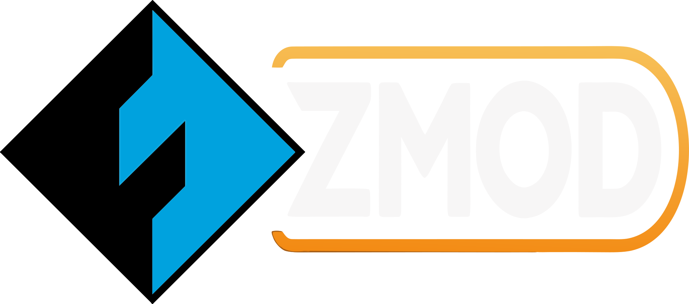
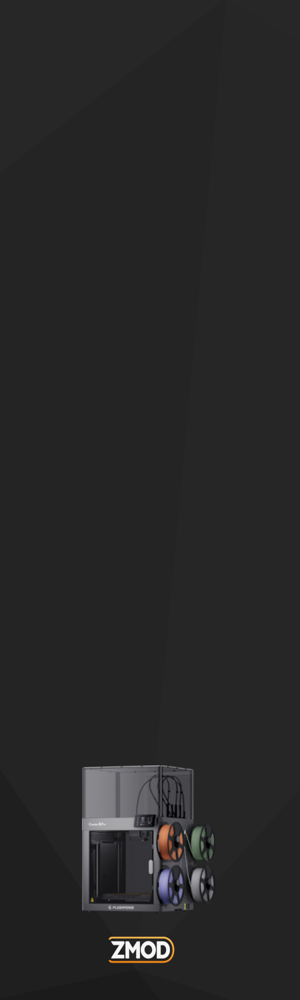
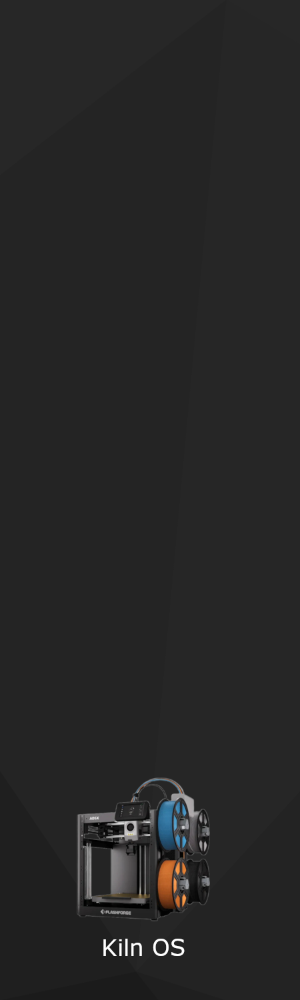

# FF_Themes

> **Parts:** the printers, boards, readers and other gear that go with this project are listed at [projects.die-hard.net/gear](https://projects.die-hard.net/gear) (Amazon affiliate links).

Mainsail (and Fluidd) themes for Flashforge printers, as one plugin that works on both
[Zmod](https://github.com/ghzserg/zmod) and [Kiln OS](https://github.com/djvalic/kiln-os).
It picks the theme for the printer it's installed on and keeps it up to
date through the update manager.

| Firmware | Printer | Theme folder |
| :--- | :--- | :--- |
| Zmod | AD5X | `themes/zmod-ad5x` |
| Zmod | Creator 5 Pro | `themes/zmod-c5` |
| Kiln OS | AD5X | `themes/kiln-ad5x` |

Each theme folder holds what Mainsail looks for in the hidden `.theme`
folder in the config files:

| File | What it is |
| :--- | :--- |
| `sidebar-logo.svg` | Logo at the top of the sidebar |
| `sidebar-background.png` | Sidebar background |
| `main-background.png` | Page background |
| `custom.css` | Zmod themes only: Zmod's dialog button fix; Zmod also checks for this file on boot |

### The images

What the themes install, and where each image shows up in the web UI:

| File | Image shown | Where it appears |
| :--- | :---: | :--- |
| `sidebar-logo.svg` | <br>Zmod (AD5X and Creator 5 Pro)<br><br><br>Kiln OS (AD5X) | **Mainsail:** top of the sidebar, above the menu<br>**Fluidd:** top bar, left corner |
| `sidebar-background.png` |   <br>Zmod AD5X, Zmod Creator 5 Pro, Kiln OS AD5X | **Mainsail:** behind the sidebar menu |
| `main-background.png` | <br>All three themes | **Mainsail:** page background, behind the dashboard panels |
| `logos/kiln-os-icon-background.svg` | <br>Kiln OS (AD5X) only | **Fluidd:** bottom right of the page, behind the panels. The Zmod themes keep Fluidd's own logo there. |

Fluidd doesn't get the two PNG backgrounds; it only takes the logos.

### Fluidd

Each theme has a Fluidd part too, in `fluidd-themes/<theme>`. It puts the
Mainsail theme's `sidebar-logo.svg` in Fluidd's top bar, in place of
Fluidd's own logo.

| Theme | Top bar | Bottom right background logo |
| :--- | :--- | :--- |
| `zmod-ad5x`, `zmod-c5` | The Mainsail sidebar logo | Fluidd's, unchanged |
| `kiln-ad5x` | The Mainsail sidebar logo | Kiln OS icon, a bit smaller and closer to the corner than Fluidd's |

The background logo only shows while **Show background logo** is on in
Fluidd's theme settings (the default).

The Zmod ones start with Zmod's own Fluidd `custom.css` (its dialog fixes,
kept in `tools/zmod-fluidd-base.css`), because Zmod puts that file in
`.fluidd-theme` and checks for it on boot.

Fluidd reads only `custom.css` and `background.*` from its `.fluidd-theme`
folder; there's no logo file. So `custom.css` carries the logo itself (as
an embedded image), hides Fluidd's logo and widens the top bar's logo box
to fit, and does the same for the background logo.
`tools/fluidd_logo_css.py` makes it from `sidebar-logo.svg`, with an
optional background logo and a stylesheet to put first:

```sh
python3 tools/fluidd_logo_css.py themes/kiln-ad5x/sidebar-logo.svg fluidd-themes/kiln-ad5x/custom.css --background logos/kiln-os-icon-background.svg
python3 tools/fluidd_logo_css.py themes/zmod-ad5x/sidebar-logo.svg fluidd-themes/zmod-ad5x/custom.css --base tools/zmod-fluidd-base.css
python3 tools/fluidd_logo_css.py themes/zmod-c5/sidebar-logo.svg fluidd-themes/zmod-c5/custom.css --base tools/zmod-fluidd-base.css
```

The background logo is drawn fully opaque, so its file carries its own
transparency: `logos/kiln-os-icon-background.svg` is `logos/kiln-os-icon.svg`
with the black at 75% opacity and the blue at 12%. Change those `opacity`
values to make either color stronger or fainter.

## Zmod

### Install

Add this to `mod_data/user.moonraker.conf`:

```ini
[update_manager ff_themes]
type: git_repo
channel: stable
path: /root/printer_data/config/mod_data/plugins/ff_themes
origin: https://github.com/DIEHARDave/FF_Themes.git
is_system_service: False
primary_branch: main
```

Then run `ENABLE_PLUGIN name=ff_themes` in the console and reload Mainsail
or Fluidd with Ctrl+F5. Zmod restarts Klipper's firmware after enabling a plugin, so
don't enable it during a print.

The installer reads Zmod's printer settings (`AD5X=1` or `C5PRO=1`) and
links the matching Mainsail and Fluidd themes. On any other printer it stops without changing
anything; run `DISABLE_PLUGIN name=ff_themes` to take it out of the plugin
list again.

Coming from `zmod_ad5x_theme`? Run `DISABLE_PLUGIN name=zmod_ad5x_theme`
first, so it puts your old theme back, then enable `ff_themes`. The
installer stops and tells you to do this if it finds the old plugin's theme.

Theme file updates arrive through the links by themselves. When an update
adds a new part, like the Fluidd themes in 1.3.0, run
`ENABLE_PLUGIN name=ff_themes` again to link it.

### Theme doesn't show up

On Zmod, Mainsail sometimes keeps showing the old theme after an install,
an update or a hand upload, even after Ctrl+F5. Mainsail loads the theme
last, after the config file list, and it doesn't always pick up the new
files. To make the theme active:

1. Open **Machine**, and in the **Config Files** panel click refresh.
2. Open the `.theme` folder (turn on **Show hidden files** under the gear
   icon if you can't see it) and click refresh again.

The new theme appears.

### Uninstall

Run `DISABLE_PLUGIN name=ff_themes`. Your previous themes come back, or
Zmod's defaults if you didn't have any.

### Your existing theme

The installer never deletes a theme. Zmod keeps the themes in
`mod_data/.theme` (Mainsail) and `mod_data/.fluidd-theme` (Fluidd). If
those folders exist, they are moved to `mod_data/ff_themes_backup/` before
the plugin's themes go in, and `DISABLE_PLUGIN` moves them back.

If you install again later and find a theme folder that isn't the
plugin's, the first backup stays the one that gets restored. The newer
folder is set aside next to it with the date added to its name.

| Path | What it is |
| :--- | :--- |
| `config/.theme` | Zmod's link to `mod_data/.theme`; left as it is. |
| `config/mod_data/.theme` | Link to this plugin's Mainsail theme for the printer. |
| `config/.fluidd-theme` | Zmod's link to `mod_data/.fluidd-theme`; left as it is. |
| `config/mod_data/.fluidd-theme` | Link to this plugin's Fluidd theme for the printer. |
| `config/mod_data/ff_themes_backup/` | The themes that were there before, if any. |

## Kiln OS

### Install

Over SSH as root (Kiln's default password is `root`):

```sh
cd /data/ad5x/plugins
su klipper -s /bin/sh -c 'git clone https://github.com/DIEHARDave/FF_Themes.git ff_themes'
```

Then in the console (Mainsail, Fluidd or HelixScreen):

```
ENABLE_PLUGIN NAME=ff_themes
```

Klipper restarts and copies the Mainsail theme into the config folder's
`.theme` and the Fluidd theme into `.fluidd-theme`. Reload the page with
Ctrl+F5. Software Updates now lists `ff_themes`.
Nothing runs as root.

Kiln plugins have no install script, so the plugin's Klipper module
(`extras/ff_themes.py`) does the work each time Klipper starts: it copies
any theme file that changed and removes files that aren't part of the
theme. After an update, run `RESTART` to pick up new theme files.

| Command | What it does |
| :--- | :--- |
| `FF_THEME` | Shows the installed themes and whether a backup is waiting |
| `FF_THEME_RESTORE` | Puts back the themes from before the plugin; run it before `DISABLE_PLUGIN` |

### Uninstall

```
FF_THEME_RESTORE
DISABLE_PLUGIN NAME=ff_themes
```

`FF_THEME_RESTORE` has to come first. Once the plugin is off, its module
no longer loads, so nothing is left to restore the old themes. If you
disable it without restoring, the plugin's themes just stay where they
are, and your old ones are still in `config/ff_themes_backup/`.

### Your existing theme

The themes are plain `.theme` (Mainsail) and `.fluidd-theme` (Fluidd)
folders in the config files. The plugin marks its own copies with a
`.ff_themes` file. Any other folder of that name is moved to
`config/ff_themes_backup/` before the plugin's theme goes in. As
on Zmod, the first backup is the one that gets restored; a later one is
set aside next to it with the date added to its name.

## Without the plugin

The themes are plain files, so you can also put them on the printer by
hand. They won't update by themselves then. Don't do both: if the plugin
is on, uninstall it first (see above). On Zmod a hand upload would write
into the plugin's folder through its link; on Kiln the plugin replaces the
files at the next Klipper start.

### Get the files

Open the theme folder for your printer on GitHub (`themes/zmod-ad5x`,
`themes/zmod-c5` or `themes/kiln-ad5x`; for Fluidd, the same name under
`fluidd-themes/`) and download each file with the
"Download raw file" button. Or use **Code > Download ZIP** and unzip it.

You need every file in that folder. On Zmod, `custom.css` matters: when
Zmod boots and `.theme` has no `custom.css`, it copies its default theme
back over the folder, and your logo goes with it.

### Upload through Mainsail

1. Open **Machine** in Mainsail.
2. In the **Config Files** panel, click the gear icon and turn on
   **Show hidden files**.
3. If there is no `.theme` folder, create it with the create-folder
   button (folder icon) and name it `.theme`.
4. Open `.theme` and upload the theme files with the upload button. Let
   them replace the files that are already there.
5. Reload Mainsail with Ctrl+F5.

For the Fluidd theme, do the same in Fluidd: **Configuration**, show
hidden files in the file list's settings, create `.fluidd-theme` if it
isn't there and upload `custom.css` into it. On Zmod it replaces Zmod's
own `custom.css`; the theme's copy already includes Zmod's part.

On Zmod, `.theme` in the config root is a link to `mod_data/.theme`, so the
files end up there. That's expected. If the old theme is still showing,
see [Theme doesn't show up](#theme-doesnt-show-up).

### Copy with scp

| Firmware | Folder on the printer |
| :--- | :--- |
| Zmod (AD5X, Creator 5 Pro) | `/opt/config/mod_data/.theme/` |
| Zmod, Fluidd | `/opt/config/mod_data/.fluidd-theme/` |
| Kiln OS | `/home/klipper/printer_data/config/.theme/` |
| Kiln OS, Fluidd | `/home/klipper/printer_data/config/.fluidd-theme/` |

Neither printer has an SFTP server, so use `scp -O` (the old scp protocol).
The default password is `root` on both. From the unzipped theme folder:

```sh
# Zmod
ssh root@<printer> 'mkdir -p /opt/config/mod_data/.theme'
scp -O * root@<printer>:/opt/config/mod_data/.theme/

# Zmod, Fluidd (from fluidd-themes/zmod-ad5x or zmod-c5)
scp -O custom.css root@<printer>:/opt/config/mod_data/.fluidd-theme/

# Kiln OS
ssh root@<printer> 'mkdir -p /home/klipper/printer_data/config/.theme'
scp -O * root@<printer>:/home/klipper/printer_data/config/.theme/
ssh root@<printer> 'cd /home/klipper/printer_data/config && chown -R klipper:klipper .theme && chmod -R a+rX .theme'

# Kiln OS, Fluidd (from fluidd-themes/kiln-ad5x)
ssh root@<printer> 'mkdir -p /home/klipper/printer_data/config/.fluidd-theme'
scp -O custom.css root@<printer>:/home/klipper/printer_data/config/.fluidd-theme/
ssh root@<printer> 'cd /home/klipper/printer_data/config && chown -R klipper:klipper .fluidd-theme && chmod -R a+rX .fluidd-theme'
```

The `chown` lines matter on Kiln: files copied in as root are owned by root
and readable only by root, so Moonraker, which runs as `klipper`, can't
serve them to the web UI.

Reload Mainsail with Ctrl+F5. On Zmod, if the old theme is still showing,
see [Theme doesn't show up](#theme-doesnt-show-up).

## Adding a theme

1. Add a folder under `themes/`.
2. On Zmod, pick it in `install.sh` from the settings in Zmod's `0.sh`.
   Zmod themes need a `custom.css`, or Zmod's boot script writes one
   through the link into this repository.
3. On Kiln, set `theme:` under `[ff_themes]` in `plugin.cfg`.
4. For Fluidd, add a folder of the same name under `fluidd-themes/` with
   a `custom.css` (see [Fluidd](#fluidd)). Both installers pick it up when
   it's there.

## License

GPL-3.0, see [LICENSE](LICENSE).
